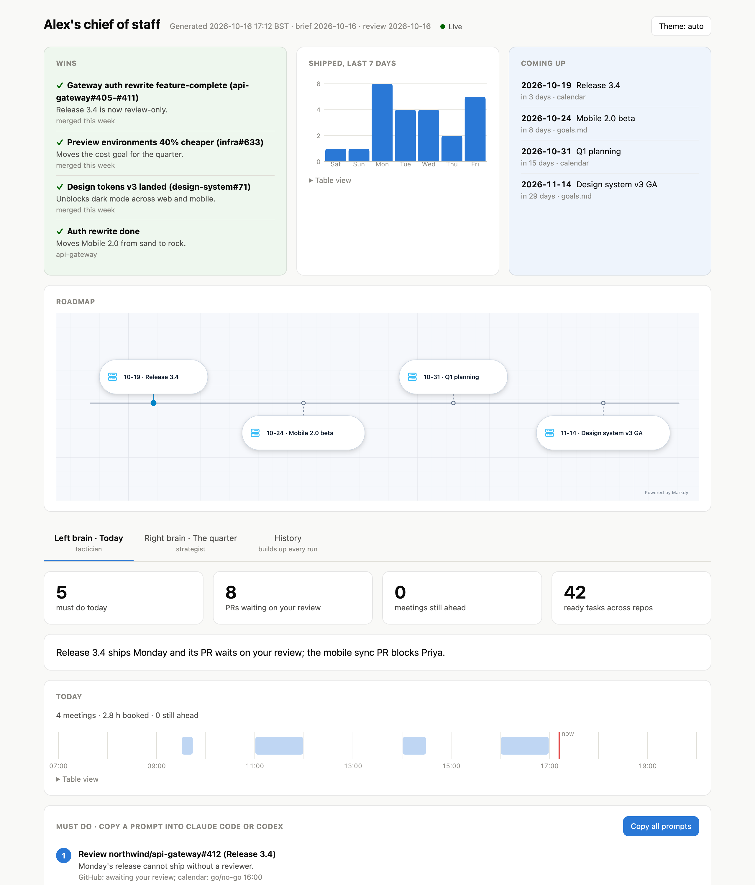
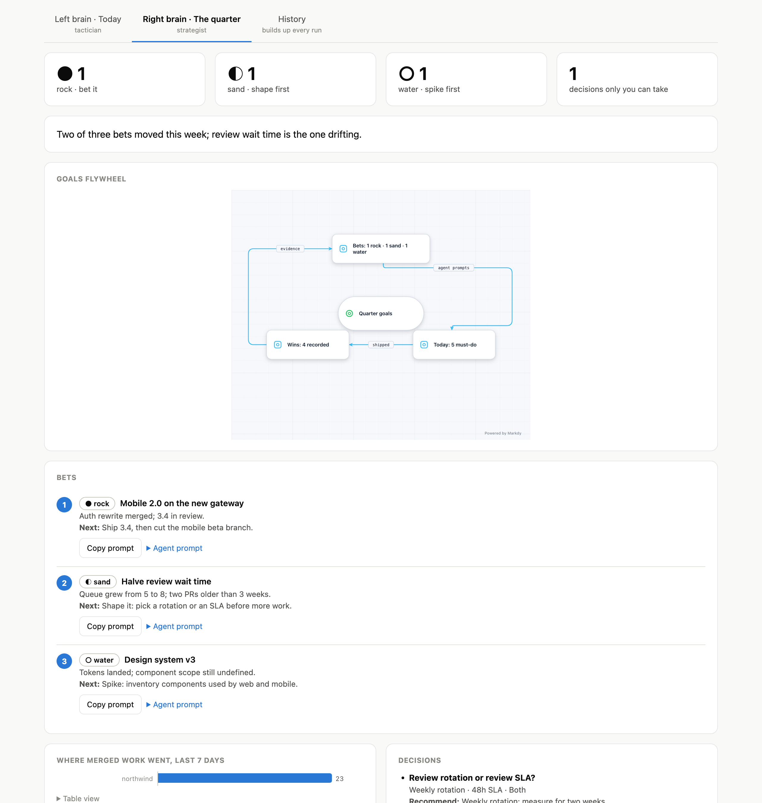
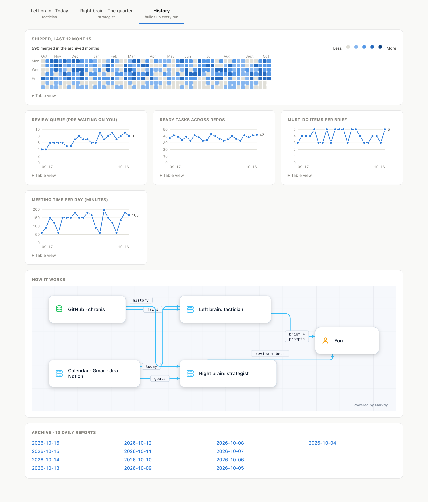

<div align="center">

# cos

**A chief of staff with two brains.**<br>
Every morning it reads your calendar, mail, tickets and PRs, tells you who is
waiting on you, and hands you a ready-to-paste agent prompt for each thing to do.

[](.github/workflows/ci.yml)
[](LICENSE)
[](Cargo.toml)

[](#install)
[](#where-it-runs)
[](#install)
[](#what-it-does)

[Install](#install) · [What it does](#what-it-does) · [Where it runs](#where-it-runs) · [Try the demo](#try-the-demo) · [Limits](#limits)

</div>

<picture>
  <source media="(prefers-color-scheme: dark)" srcset="docs/assets/today-dark.png">
  
</picture>

<sub>Every screenshot here is the synthetic demo (`task demo`): a fictional person, company, repos and teammates.</sub>

---

A working day spreads across a calendar, an inbox, a tracker and a review
queue, and the cost is the thing nobody surfaces: who is blocked on you. `cos`
reads all of them, ranks at most five actions by who is waiting, and checks the
week against your written goals. A brief costs about **$0.35** and finishes
inside its **300 s** deadline; it is **read-only** and every item cites its
source.

| | Horizon | You get |
|---|---|---|
| **Left brain** · tactician | today | ranked must-dos with a copyable agent prompt each, meeting prep, blockers, what was *not* read |
| **Right brain** · strategist | the quarter | each goal as rock / sand / water, drift, decisions only you can take |
| **History** | every run | a year of shipped work, trends, and an archive of daily reports |

<table>
<tr>
<td width="50%"></td>
<td width="50%"></td>
</tr>
</table>

## Install

Needs Claude Code logged in (`claude`), `gh`, Rust and [Task](https://taskfile.dev).
Connect Calendar, Gmail, Atlassian or Notion in claude.ai (`/mcp`).

```sh
git clone https://github.com/decebal/chief-of-staff-v1 && cd chief-of-staff-v1
task setup                  # seed context/, build, install cos + agents
$EDITOR context/profile.md context/goals.md
cos brief                   # first brief, opens the report
task schedule               # weekdays 08:30 brief, Fridays 16:00 review
```

## What it does

| | |
|---|---|
| **Reads** | Calendar, Gmail, Jira/Confluence, Notion through your claude.ai connectors; open, review-requested and merged PRs (`gh`); ready tasks (`cn`) |
| **Writes** | `out/` only: briefs, reviews, facts, the history ledger, dated HTML reports. Nothing is sent, merged, commented or edited — tools outside an explicit allowlist are denied, and the brains get no file tools (`context/` is inlined) |
| **Prompts** | each must-do and each bet ships a self-contained prompt for Claude Code or Codex that stops before anything outward-facing |
| **Agents** | `cos agents spawn --from brief --item 2` runs that prompt: Claude Code or Codex in its own worktree, sandboxed with no network, under a supervisor with a deadline and a spend cap; `cos agents watch` / `tail -f` / `kill` |
| **Charts** | numbers from the facts `cos` collects, never from the model; hand-built SVG with a validated palette, light and dark |
| **Diagrams** | roadmap, goals flywheel and architecture via [Markdy](https://markdy.com) 1.5.7, vendored inline, generated from data |
| **Archives** | one row per day plus every merged PR, seeded with the last year; `cos dash` serves it live |
| **Bounds** | every child process has one deadline and is killed and reaped with its group; every run has a spending cap |

## Where it runs

| | |
|---|---|
| **Terminal** | `cos brief` · `cos review` · `cos ask "release review or bug fix today?"` · `cos report` · `cos agents …` |
| **Browser, live** | `cos dash` → `127.0.0.1:8790`, reloads after every run; `/agents` for running agents; localhost only |
| **Claude Desktop · Codex** | `task install-mcp` registers `cos mcp`: `latest_brief` / `latest_review` / `agents` (free), `brief` / `review` / `ask` / `spin_off` (paid), `stop_agent` |
| **claude.ai** | `cos tunnel`: a Cloudflare quick tunnel to a read-only server that can't start paid runs |
| **Claude Code** | the three agents are installed into `~/.claude/agents/` |

## Try the demo

```sh
task demo                          # synthetic home at /tmp/cos-demo; no account touched
cos --home /tmp/cos-demo dash
```

## Limits

- **macOS for scheduling and opening the report**; everything else is plain Rust.
- **A connector you have not connected is a gap**, listed as *not read*, never an empty inbox.
- **History fills two months per run** to stay under GitHub's search rate limit; unarchived months show outlined.
- **Quick-tunnel URLs change on restart**; a stable one needs your own Cloudflare domain.
- **Markdy is pinned**: its grammar moves fast, so upgrades are deliberate (`vendor/markdy/README.md`).

Full guide (customising, Codex timeouts, the remote connector): [docs/usage.md](docs/usage.md) ·
design notes and measurements: [docs/design.md](docs/design.md).

## License

MIT
